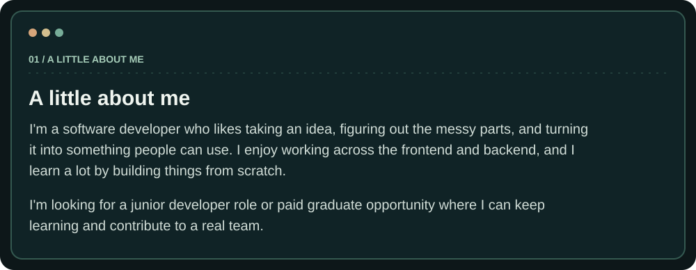
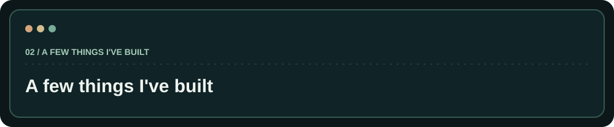
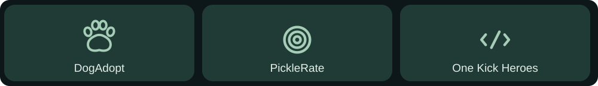
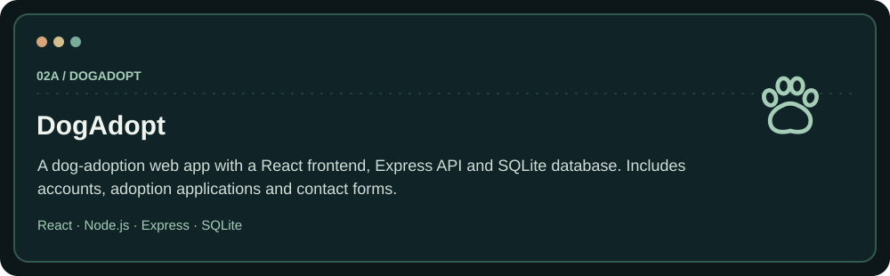
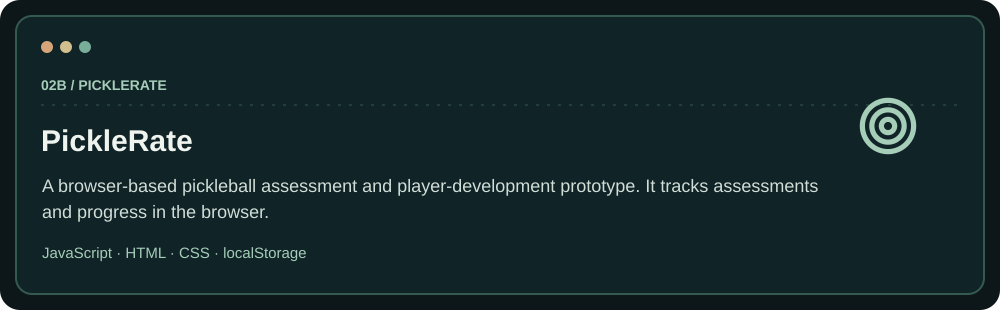
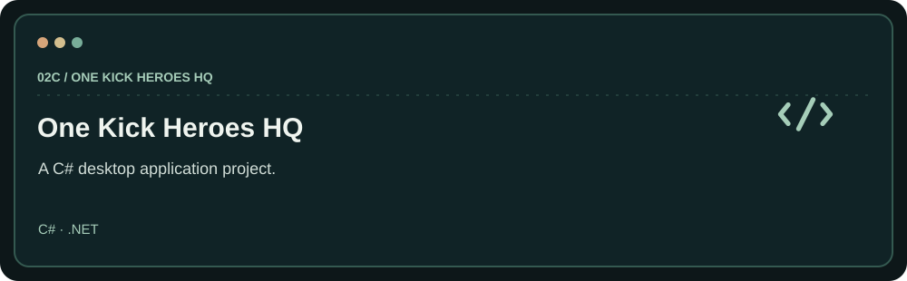
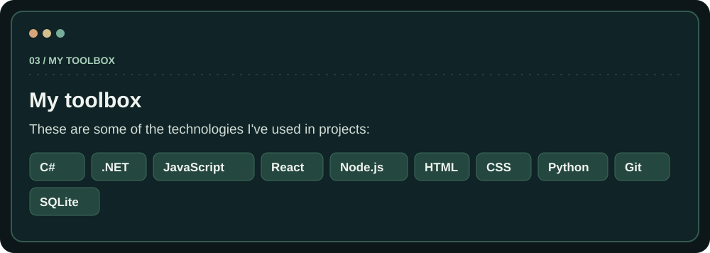
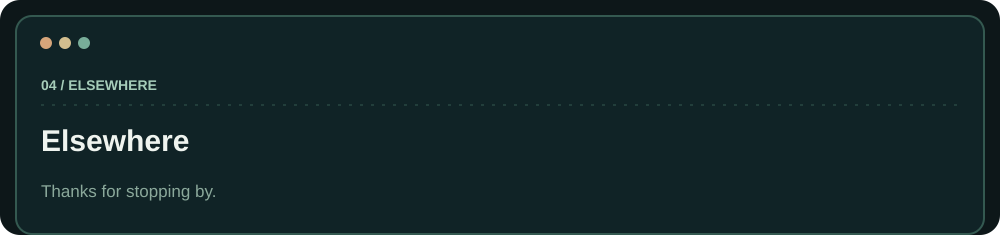

  

  

[My repositories](https://github.com/BernardSmall?tab=repositories) · [DogAdopt](https://github.com/BernardSmall/DogAdopt-Website) · [PickleRate](https://github.com/BernardSmall/Pickleball-Skill-Level-Finder-Website)
