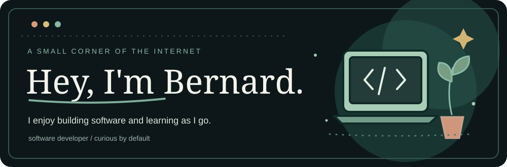

  

### A little about me

I'm a software developer who likes taking an idea, figuring out the messy parts, and turning it into something people can use. I enjoy working across the frontend and backend, and I learn a lot by building things from scratch.

I'm looking for a **junior developer role or paid graduate opportunity** where I can keep learning and contribute to a real team.

### A few things I've built

**[DogAdopt ](https://github.com/BernardSmall/DogAdopt-Website)**  
A dog-adoption web app with a React frontend, Express API and SQLite database. Includes accounts, adoption applications and contact forms.  
`React` · `Node.js` · `Express` · `SQLite`

**[PickleRate ](https://github.com/BernardSmall/Pickleball-Skill-Level-Finder-Website)**  
A browser-based pickleball assessment and player-development prototype. It tracks assessments and progress in the browser.  
`JavaScript` · `HTML` · `CSS` · `localStorage`

**[One Kick Heroes HQ ](https://github.com/BernardSmall/one-kick-heroes-hq)**  
A C# desktop application project.  
`C#` · `.NET`

### My toolbox

These are some of the technologies I've used in projects:

  

### Elsewhere

[My repositories](https://github.com/BernardSmall?tab=repositories) · [DogAdopt](https://github.com/BernardSmall/DogAdopt-Website) · [PickleRate](https://github.com/BernardSmall/Pickleball-Skill-Level-Finder-Website)

Thanks for stopping by.
